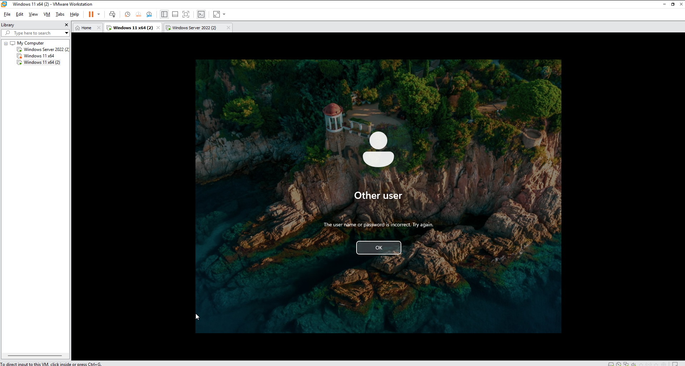
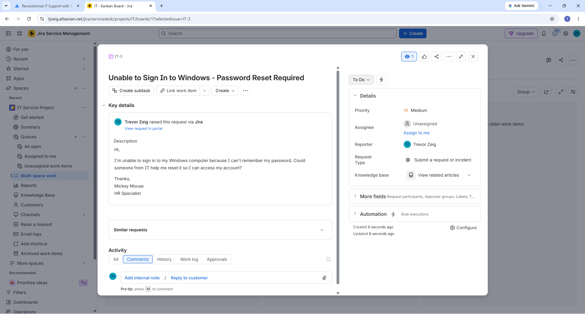
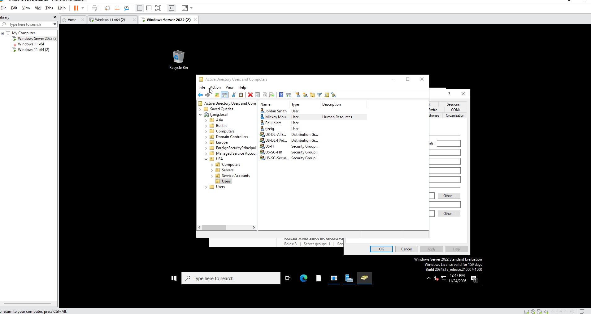
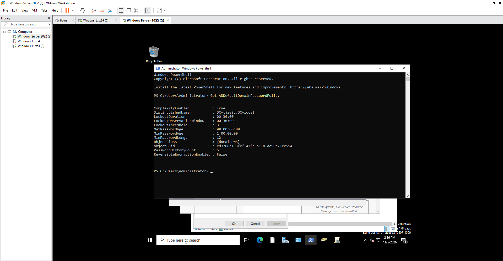
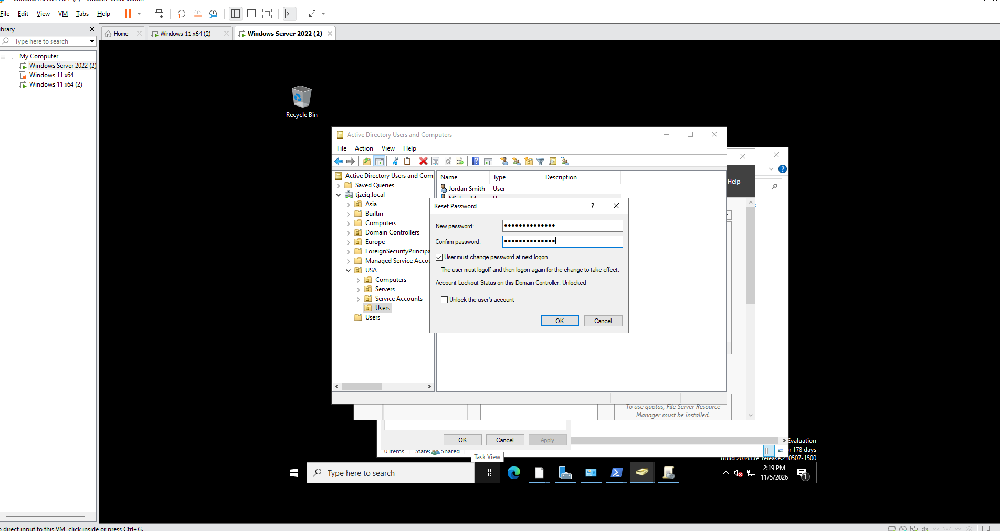
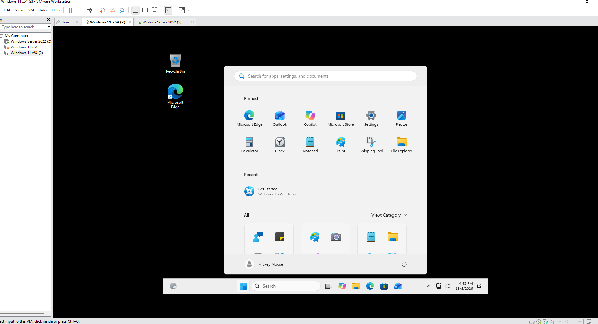

# Ticket 002: Active Directory Password Reset

## Project Overview

This project simulates a real-world IT help desk incident using Jira Service Management, Active Directory, Windows Server 2022, and Windows 11 Pro.

The objective is to investigate an employee login issue, perform an authorized password reset through Active Directory, and verify that the employee can successfully regain access to their workstation.

**Ticket Type:** Incident  
**Priority:** Medium  
**Status:** In Progress  
**Affected User:** Mickey Mouse  
**Department:** Human Resources  
**Job Title:** HR Specialist  
**Domain:** tjzeig.local  
**Username:** Mickey  

> **Note:** All employee accounts and support requests are fictional and created for educational purposes.

---

## 1. Lab Environment

| Component | Description |
|---|---|
| Hypervisor | VMware Workstation |
| Domain Controller | Windows Server 2022 |
| Client Workstation | Windows 11 Pro |
| Domain | tjzeig.local |
| Directory Services | Active Directory Domain Services |
| Administration Tool | Active Directory Users and Computers |
| Ticketing System | Jira Service Management |
| Affected Account | TJZEIG\Mickey |

The Windows 11 Pro workstation is joined to the `tjzeig.local` domain.

User accounts are centrally managed through Active Directory on Windows Server 2022.

---

## 2. Incident Description

An HR Specialist reported being unable to sign in to their Windows workstation after forgetting their domain account password.

The employee requires access to their workstation to perform daily job responsibilities.

### Reported Error

"The user name or password is incorrect."

### Screenshot: Windows Login Error

The employee attempted to sign in using their domain credentials but was unable to authenticate successfully.



### Business Impact

The employee is unable to access their workstation, network resources, and applications required to perform daily responsibilities.

### Expected Result

The employee should be able to authenticate successfully using their domain account after an authorized password reset.

---

## 3. Jira Ticket Creation

Created an incident in Jira Service Management to simulate an employee submitting a technical support request.

### Ticket Summary

Unable to Sign In to Windows – Password Reset Required

### Employee Request

Hi,

I'm having trouble signing in to my Windows workstation. I believe I forgot my password, and whenever I attempt to log in, I receive an error stating that my username or password is incorrect.

Could someone from IT please help me reset my password so I can regain access to my workstation?

Thanks,  
Mickey Mouse  
HR Specialist

### Ticket Management

- Created an incident in Jira Service Management.
- Assigned the ticket to the IT support technician.
- Set the ticket priority to Medium.
- Changed the ticket status to In Progress.
- Began investigating the reported login issue.

**Screenshot:**



---

## 4. Troubleshooting: Initial Investigation

Before resetting the employee's password, the following potential causes were considered:

- Incorrect username.
- Incorrect or forgotten password.
- Locked Active Directory account.
- Disabled Active Directory account.
- Expired password.
- Domain connectivity issues.

### Identity Verification

Before performing the password reset, the employee's identity must be verified according to organizational security procedures.

For this simulated incident, identity verification is represented as an approved help desk procedure.

In a production environment, password resets should not be performed without appropriate identity verification.

---

## 5. Troubleshooting: Locating the Active Directory Account

On Windows Server 2022:

1. Open Server Manager.
2. Select **Tools**.
3. Open **Active Directory Users and Computers**.
4. Expand the `tjzeig.local` domain.
5. Expand the `US` Organizational Unit.
6. Open the `Users` Organizational Unit.
7. Locate the affected employee's account.

### Account Information

| Attribute | Value |
|---|---|
| Employee Name | Mickey Mouse |
| Username | Mickey |
| Department | Human Resources |
| Job Title | HR Specialist |
| Domain | tjzeig.local |
| Organizational Unit | US → Users |

### Account Status Verification

Before resetting the password, review the following:

- Confirm that the account exists.
- Confirm that the account is enabled.
- Determine whether the account is locked.
- Confirm that the correct employee account has been selected.

### Findings

_Record the observed account status before proceeding with the password reset._

**Screenshot:**



---

## 6. Troubleshooting: Domain Password Policy

Before assigning a temporary password, review the applicable domain password policy.

On Windows Server 2022, open PowerShell and execute:

```powershell
Get-ADDefaultDomainPasswordPolicy
```

### Password Policy Requirements

| Policy | Requirement |
|---|---|
| Minimum Password Length | 12 characters |
| Password Complexity | Enabled |
| Password History | 5 passwords |
| Minimum Password Age | 1 day |

The temporary password must comply with the applicable password policy.

Password complexity requirements prevent the use of weak passwords and passwords containing prohibited portions of the employee's account or full name.

If a fine-grained password policy applies to the employee, its requirements must also be considered.

### Security Considerations

- Do not reuse previous passwords.
- Do not include the employee's username in the temporary password.
- Do not disclose passwords in Jira tickets.
- Do not include passwords in GitHub documentation.
- Communicate temporary credentials through an approved secure channel.
- Require the employee to change the temporary password at the next sign-in.

**Screenshot:**



---

## 7. Resolution: Active Directory Password Reset

**Status: Pending Implementation**

### Password Reset Procedure

On Windows Server 2022:

1. Open **Active Directory Users and Computers**.
2. Navigate to the affected employee's Organizational Unit.
3. Locate the Mickey Mouse user account.
4. Right-click the account.
5. Select **Reset Password**.
6. Enter a temporary password that complies with the applicable password policy.
7. Confirm the temporary password.
8. Select **User must change password at next logon**.
9. Select **Unlock the user's account** if the account is locked.
10. Click **OK**.
11. Confirm that Active Directory successfully resets the password.

### Security Considerations

The password reset is performed only on the affected employee's account.

No unnecessary changes are made to:

- Security group memberships.
- Organizational Unit assignments.
- Administrative privileges.
- Network share permissions.
- Domain password policies.

The employee is required to establish a new password at the next sign-in.

**Screenshot:**



> Temporary and permanent passwords are intentionally excluded from this documentation.

---

## 8. Verification: Windows 11 Authentication

**Status: Pending Verification**

After completing the password reset:

1. Switch to the Windows 11 Pro domain-joined workstation.
2. Navigate to the Windows sign-in screen.
3. Select **Other user** if necessary.
4. Enter the domain username:

   `TJZEIG\Mickey`

5. Enter the temporary password.
6. Confirm that Windows accepts the temporary credentials.
7. Verify that Windows requires the employee to change their password.
8. Enter a new password that complies with the applicable password policy.
9. Confirm the new password.
10. Complete the sign-in process.
11. Verify that the Windows desktop loads successfully.


**Screenshot:**



---

## 9. Jira Resolution Documentation

**Status: Pending Resolution**

### Proposed Internal Note

Investigated the reported Windows authentication issue for the affected employee.

Located the employee's Active Directory account and reviewed the account status and applicable password policy requirements.

Performed an authorized password reset through Active Directory Users and Computers.

Configured the account to require a password change at the next sign-in.

Final verification will confirm that the employee can authenticate successfully using the temporary credentials, establish a new password, and regain access to the Windows workstation.

### Proposed Employee Response

Hi Mickey,

Your domain account password has been reset.

Please sign in to your workstation using the temporary credentials provided through the approved secure channel. You will be prompted to create a new password during the sign-in process.

Please let IT know if you experience any additional issues accessing your workstation.

Thanks,  
IT Support

### Ticket Closure

After successful verification:

- Document the identified cause of the login issue.
- Record the password reset procedure.
- Confirm successful domain authentication.
- Document the employee's successful password change.
- Send the resolution response to the employee.
- Change the Jira ticket status to Resolved.

**Screenshot:**


**Screenshot:**


---

## 10. Skills Demonstrated

- Jira Service Management
- IT incident management
- Active Directory administration
- Active Directory Users and Computers
- Windows Server 2022 administration
- Windows 11 troubleshooting
- Domain authentication
- User account management
- Password reset procedures
- Account lockout troubleshooting
- Group Policy and password policy review
- PowerShell
- Identity and access management
- Security best practices
- Technical documentation
- End-user communication

---

## 11. Key Takeaways

This exercise demonstrates how an IT help desk technician can investigate and resolve a domain authentication issue using Active Directory.

The exercise emphasizes the importance of verifying employee identity, reviewing account status, understanding password policy requirements, and following secure password reset procedures.

Requiring the employee to change their temporary password at the next sign-in helps protect account security and ensures that the employee establishes their own credentials.

Successful authentication must be verified before closing the incident.

**Final outcome:** Pending password reset and successful verification.

